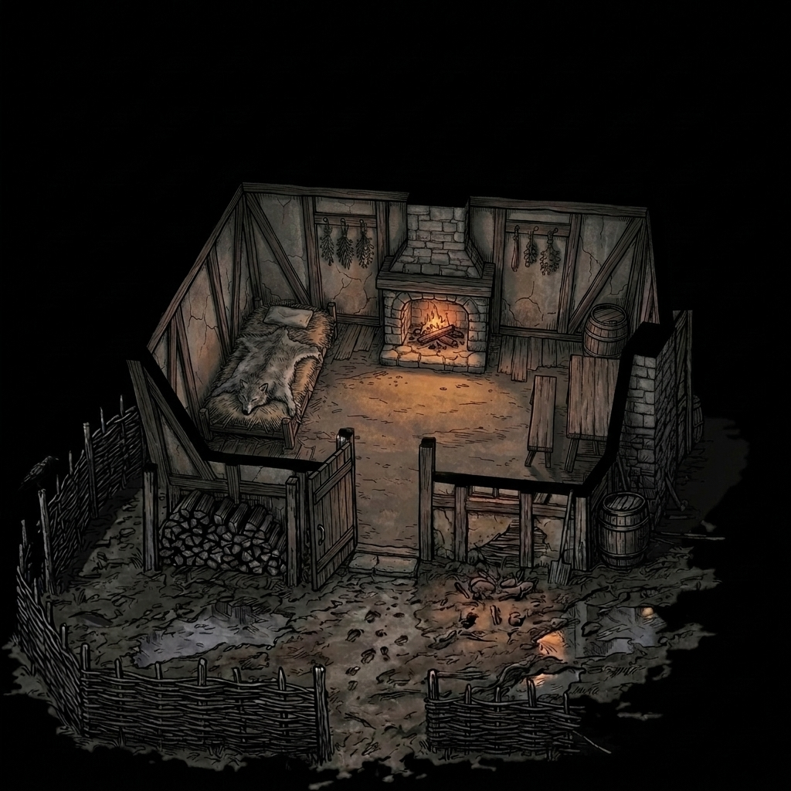

# Chata bez dachu (przekrój), do wejścia jak w Tibii

Obraz od Patryka z Gemini (24 XI, 13:34), zrobiony poleceniem z [docs/chata.md](../../docs/chata.md) na wzorze `chata-wzor.png` (czyli [grafika/chata.webp](../chata.webp)) i obrazie izby ([chata-wnetrze.jpg](chata-wnetrze.jpg)).

Opis od Gemini w skrócie: ta sama chata, ta sama pozycja podwórka, płotu, kruka, kałuż, stosu drewna, łopaty i beczki; izba leży na poziomie gruntu zaraz za otwartymi drzwiami; czarne tło jak w chacie z dachem.

Do gry: [narzedzia/chata-bez-dachu.py](../../narzedzia/chata-bez-dachu.py) robi z niego [grafika/chata-bez-dachu.webp](../chata-bez-dachu.webp) (skala 951/1024, bez przesunięcia, tło zdjęte obrysem). Ścieżki do plików na komputerze Patryka zdjęte z tej kopii (Claude).
