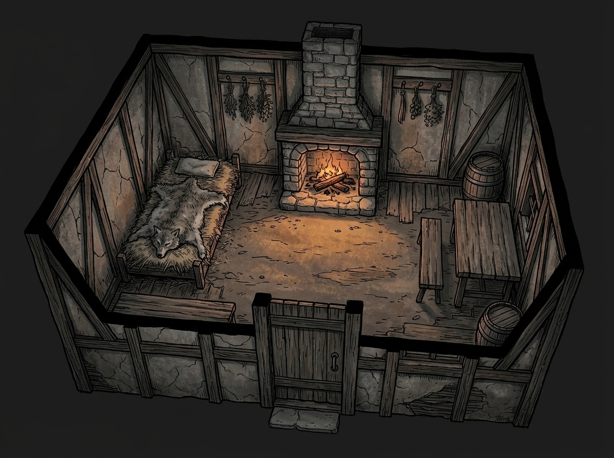

# Wnętrze chaty (noc — schronienie między nocami)

Wygenerowane na bazie referencji zewnętrznej chaty, zgodnie ze stałym dopiskiem stylu z `docs/grafika.md` (bez nazw cudzych dzieł i bez ludzi/tekstu). Cały środek podłogi jest otwarty pod poruszanie się postaci w 2D, a wszystkie obiekty stoją przy ścianach:
- **Góra (tylna ściana):** kamienne palenisko z niskim ogniem i wiszące pęki suszonych ziół.
- **Lewo:** siennik z wilczą skórą (do leczenia / odpoczynku).
- **Prawo:** drewniana ława, stół i beczki w narożnikach.
- **Dół (przednia ściana):** te same deskowe drzwi z żelaznym uchwytem i kamiennym progiem co na zewnątrz.

Opis od Patryka (24 XI, 12:15), wygenerowany przez Gemini razem z obrazem. Ścieżki do plików na jego komputerze zdjęte z tej kopii (Claude). W grze obraz jest jako [grafika/wnetrze.webp](../wnetrze.webp), a przeszkody i podłoga są w `WNETRZE` w [gra/swiat.js](../../gra/swiat.js); opis w [docs/chata.md](../../docs/chata.md).
